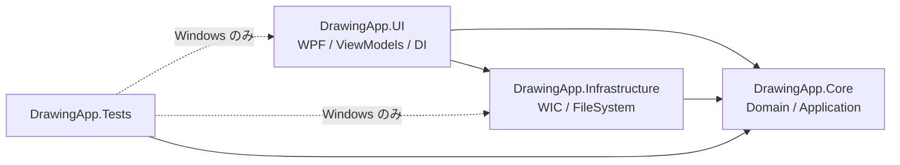
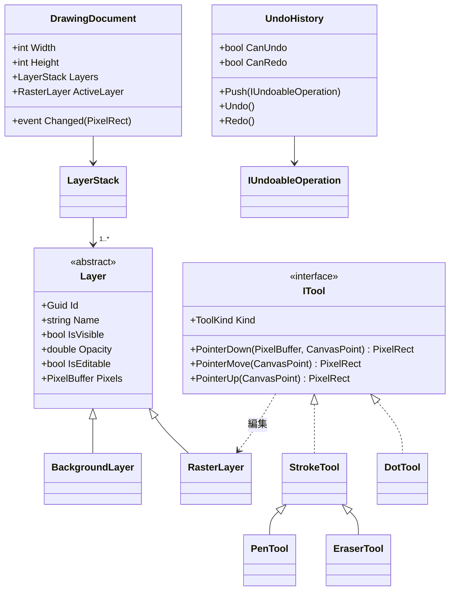
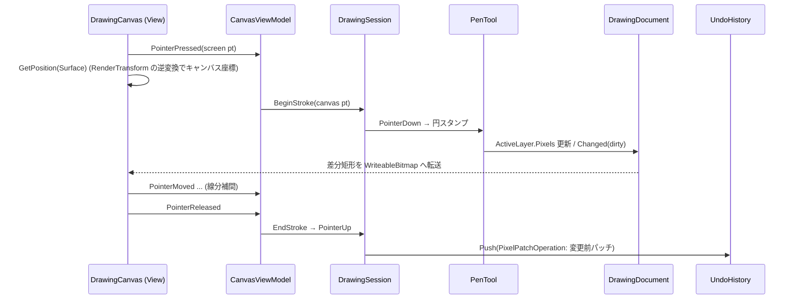
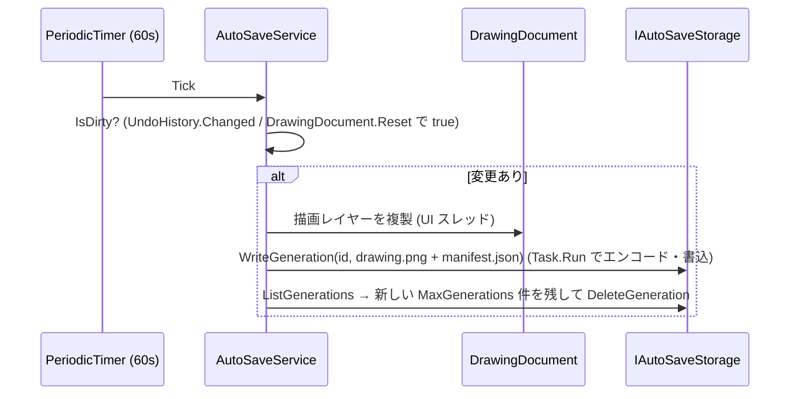

# Architecture

DrawingApp のアーキテクチャ設計書。要求・仮定は [ProductBacklog.md](ProductBacklog.md)、リスクは [Risks.md](Risks.md) を参照。

## 1. 設計方針

| 方針 | 内容 |
|----|----|
| Clean Architecture | ドメイン・ユースケースを `DrawingApp.Core` に集約し、UI・OS 依存 (WPF / WIC / ファイル) は外側の層に置く |
| MVVM | View (XAML) はバインディングと入力転送のみ。状態とロジックは ViewModel、ドメイン処理は Core |
| Dependency Injection | `Microsoft.Extensions.Hosting` の Generic Host をコンポジションルートとする |
| テスト容易性 | Core は `net10.0` (OS 非依存) とし、どの OS でも Unit Test 可能にする。時間・ファイル・画像コーデックはポート (interface) で抽象化 |
| 拡張性 | レイヤー・ツール・エンコーダを抽象化し、色/複数レイヤー/図形/テキスト/SVG/WebP を既存コードの改修最小で追加可能にする |

## 2. ソリューション構成

```
DrawingApp.slnx
global.json                      .NET 10 SDK 固定
Directory.Build.props            共通ビルド設定 (Nullable, TreatWarningsAsErrors, Analyzers)
Directory.Packages.props         NuGet 版数の一元管理 (Central Package Management)
src/
  DrawingApp.Core/               net10.0          ドメイン + アプリケーション層
  DrawingApp.Infrastructure/     net10.0-windows  WIC 画像入出力, ファイル保存, 時計
  DrawingApp.UI/                 net10.0-windows  WPF View / ViewModel / コンポジションルート
tests/
  DrawingApp.Tests/              xUnit (Windows: net10.0-windows / その他 OS: net10.0 で Core のみ)
docs/
  README.md  Architecture.md  UserManual.md  ProductBacklog.md  Roadmap.md  Risks.md
.github/workflows/ci.yml
```

### 依存方向



- Core は他プロジェクト・WPF・`System.Windows.*` を参照しない
- ViewModel は `System.Windows.*` を参照しない (WPF 型は View とアダプタに閉じ込める)
- UI が Infrastructure を参照するのはコンポジションルート (DI 登録) のみ

## 3. レイヤー詳細

### 3.1 DrawingApp.Core

```
Core/
  Domain/
    Imaging/       PixelBuffer (BGRA32), RgbaColor, PixelRect, CanvasPoint
    Layers/        Layer (abstract), BackgroundLayer, RasterLayer, LayerStack
    Documents/     DrawingDocument (キャンバスサイズ + LayerStack + 変更通知)
    Tools/         ITool, StrokeTool (PenTool / EraserTool), DotTool, ToolKind, ToolOptions, BrushSizePresets
    Rasterization/ RoundBrushRasterizer, BlendMode (Paint / Erase)
    History/       IUndoableOperation, PixelPatch, PixelPatchOperation, UndoHistory
    Viewport/      ViewportState (Scale, Offset, ZoomAt, PanBy, ScreenToCanvas), ZoomPolicy (10%〜800% の段階テーブル)
  Application/
    Ports/         IImageDecoder, IImageEncoder, IImageEncoderRegistry, IAutoSaveStorage (時刻は BCL の TimeProvider)
    Services/      DrawingSession, DocumentService, ExportService, LayerCompositor
    AutoSave/      AutoSaveService, AutoSaveOptions, AutoSaveManifest
  DependencyInjection/ CoreServiceCollectionExtensions.AddCore()
```

主要モデル:



- **PixelBuffer**: `byte[]` の BGRA32 (非乗算 α)。WPF の `WriteableBitmap` (`Bgra32`) と同レイアウトで、表示時はコピーのみ
- **レイヤー分離**: ツールは `DrawingDocument.ActiveLayer` (常に `RasterLayer`) のみを編集する。`BackgroundLayer` は `IsEditable=false` で、ツールへの公開 API を持たない
- **下絵読込**: `MainViewModel.LoadBackgroundCommand` → `IDialogService.ShowOpenImageDialog()` (UI 層の抽象。実装は `WpfDialogService`) → `DocumentService.LoadBackground(path)` → `IImageDecoder.Decode` → `DrawingDocument.LoadBackground`。開けない/読めないファイルは `ImageDecodeException` になり、`IDialogService.ShowError` で表示してドキュメントは変更しない。`DrawingCanvas` は `CanvasViewModel.LayersReset` を受けて背景・描画の両ビットマップを作り直す。Undo 履歴は `Reset` でクリアする (A4、§4.3)
- **DrawingDocument**: 既定 1280x720 (背景は白、描画レイヤーは透明)。`LoadBackground(image)` でキャンバスを下絵サイズに合わせ、描画レイヤーは左上を基準に残し、はみ出した部分は切り捨てる (`PixelBuffer.Resized`)。バッファを差し替えたら `Reset` を通知し、`DrawingSession` は描画途中のストロークを破棄する
- **消しゴム**: `BlendMode.Erase` で描画レイヤーの α を 0 にする。背景は別バッファのため影響しない
- **色**: `ToolOptions.Color` (`RgbaColor`) をストローク開始時に取得してラスタライザへ渡す。初版は `RgbaColor.Black` 固定
- **ツール**: `ITool` の各メソッドは変更した領域 (`PixelRect`) を返す。`DrawingSession` が `ToolOptions.ActiveTool` に対応するツールへポインタ入力を振り分け、`Invalidated` イベントで差分矩形を通知する。ツールは DI で `ITool` として複数登録する (Undo 用の `PixelPatchOperation` はツールではなく `DrawingSession` がストローク単位で作る)
- **ラスタライズ**: `RoundBrushRasterizer` はアンチエイリアスなしの円ブラシ。奇数サイズはピクセル中心、偶数サイズはピクセル角に中心をスナップし、n px ブラシが正確に n px 幅になる。線分は `max(1, サイズ/4)` px 間隔でスタンプして途切れを防ぐ
- **ブラシサイズ**: `BrushSizePresets.Pen/Dot = {1,3,5,10,20}`, `Eraser = {10,20,50}`

### 3.2 DrawingApp.Infrastructure

| クラス | ポート | 実装 |
|----|----|----|
| `WicImageDecoder` | `IImageDecoder` | `BitmapDecoder` で PNG/JPG/JPEG を読込み、`FormatConvertedBitmap` で BGRA32 に正規化 (ファイルの DPI は無視し、画像のピクセル数 = キャンバスのピクセル数とする)。読めないデータや 4096x4096 px 相当を超える画像は `ImageDecodeException` |
| `PngImageEncoder` | `IImageEncoder` (`FormatId`=`png`, `Extensions`=`.png`) | `BitmapSource.Create(Bgra32)` → `PngBitmapEncoder` で α 付き 32bit PNG を出力。`TryAddEnumerable` で登録し、形式は複数登録できる |
| `FileAutoSaveStorage` | `IAutoSaveStorage` | `%LOCALAPPDATA%\DrawingApp\AutoSave\<世代 id>\` に世代ディレクトリを作成・列挙・削除。`<id>.tmp` に書いてからリネームするので、書きかけの世代は列挙されない。id・ファイル名にパス区切りは使えない |
| `TimeProvider.System` | `TimeProvider` | 現在時刻・タイマー (テストでは `FakeTimeProvider`) |

`AddInfrastructure()` で登録する。

### 3.3 DrawingApp.UI

```
UI/
  App.xaml(.cs)        Generic Host 起動 / 終了
  Hosting/             UiServiceCollectionExtensions.AddUi()
  Views/               MainWindow.xaml, DrawingCanvas (UserControl)
  ViewModels/          MainViewModel, ToolbarViewModel, CanvasViewModel
  Services/            IDialogService (ファイル選択・メッセージ), WpfDialogService
  Rendering/           LayerBitmapPresenter (PixelBuffer → WriteableBitmap 差分転送)
```

- MVVM ライブラリ: `CommunityToolkit.Mvvm` (`ObservableObject`, `[ObservableProperty]`, `[RelayCommand]`)
- キーバインド: `Ctrl+Z` → `UndoCommand`, `Ctrl+Y` → `RedoCommand` (`Window.InputBindings`)。コマンドは `CanvasViewModel.Undo()/Redo()` → `DrawingSession` を呼び、`CanExecute` は `UndoHistory.CanUndo/CanRedo`。`UndoHistory.Changed` → `CanvasViewModel.HistoryChanged` → `NotifyCanExecuteChanged` でメニュー項目の有効/無効が切り替わる
- 表示: `ScrollViewer` 不使用。`DrawingCanvas` が表示領域全体 (灰色・`ClipToBounds`) を占め、背景 `Image` と描画 `Image` を重ねた `Surface` に `ScaleTransform(Scale)` → `TranslateTransform(Offset)` を適用 (`CanvasViewModel.Scale/OffsetX/OffsetY` にバインド)。`e.GetPosition(Surface)` は WPF が逆変換するので、描画入力は変換なしでキャンバス画素になる。高倍率時は `BitmapScalingMode=NearestNeighbor`

## 4. 主要フロー

### 4.1 ペン描画



### 4.2 保存

- 描画のみ: `ExportService.SaveDrawingOnly(path)` → `ActiveLayer.Pixels` をそのまま `IImageEncoder(png)` へ (透過保持)
- 合成: `ExportService.SaveComposite(path)` → `LayerCompositor.Compose(LayerStack)` で可視レイヤーを下から α 合成 (ストレートα の source-over、`Opacity` を掛ける) → PNG
- UI: `SaveDrawingOnlyCommand` / `SaveCompositeCommand` → `IDialogService.ShowSaveImageDialog(title, 既定名, ExportService.Encoders)` (ファイルの種類は登録済みエンコーダから作るので、形式を追加すると自動で選択肢に出る) → `ExportService`。`ImageSaveException` は `ShowError` で表示
- エンコーダは拡張子 (`IImageEncoder.Extensions`、大文字小文字無視) で選ぶ。`<path>.tmp` に書いてから `File.Move(overwrite)` で置き換えるので、失敗しても既存ファイルが壊れない。未対応の拡張子や書込み失敗は `ImageSaveException`

### 4.3 Undo / Redo

- 1 操作 (1 ストローク / 1 点 / 1 消去ドラッグ) = 1 `PixelPatchOperation`
- 変更前の dirty 矩形パッチのみ保持。Undo 時に現状をパッチ化して Redo 用に入れ替える (メモリ半減)
- `PixelPatch` は矩形領域を Deflate (`CompressionLevel.Fastest`) で圧縮したコピー。`PixelPatchOperation` は `RasterLayer` と変更前パッチを持ち、Undo/Redo のたびに現状と入れ替える
- `UndoHistory` は件数上限 (既定 50) とバイト上限 (既定 64MB、Undo/Redo 両スタックの合計) を持ち、古い順に破棄する。バイト上限を超えても直近 20 件 (`GuaranteedOperations`) は残す
- `DrawingSession` は「最後に記録した時点の描画レイヤー」のコピー (`_committed`) を 1 枚持つ。ストローク中はツールが返す変更矩形を合算し、`EndStroke` で `_committed` からその矩形を `PixelPatch` として取り出して `UndoHistory.Push` → `_committed` の同じ矩形を現状で更新する。Undo/Redo 後も変更矩形だけ `_committed` に反映する。これでストローク開始時の全面コピーが不要になる (代わりにレイヤー 1 枚分のメモリを常に使う)
- `DrawingSession.Undo()/Redo()` はストローク中は無視し、変更矩形を `Invalidated` で通知する (ビューは通常の描画と同じ経路で再描画)
- 新規操作で Redo スタックをクリア。下絵読込 (`DrawingDocument.Reset`) で履歴と `_committed` をクリア

### 4.4 ズーム / パン

- `ZoomPolicy`: 段階テーブル `10,15,20,25,33,50,67,75,100,125,150,200,300,400,600,800 (%)`。ホイール 1 ノッチで 1 段階
- 座標系: `screen = canvas * Scale + Offset`。`ViewportState.ScreenToCanvas` がその逆変換
- `ZoomPolicy.Step(current, notches)`: 正なら current より大きい段階へ、負なら小さい段階へ notches 段移動し、表の端で止まる (表にない倍率は進む方向の次の段階へ寄せる)
- カーソル位置アンカー: `ViewportState.ZoomAt(cursor, notches)` が `offset' = cursor - (cursor - offset) * (scale' / scale)` で Offset を更新する (Core でテスト)。倍率が変わらない (端に達している) ときは何もしない
- `ViewportState` は `AddCore()` で Singleton 登録し、`Changed` イベントで View に通知する
- パン: 中ボタンドラッグ、または Space 押下中の左ドラッグ (`PreviewMouseLeftButtonDown` で横取りするので描画しない) で `Offset` を加算。`CanvasViewModel.BeginPan/PanTo/EndPan` が直前位置との差分を `ViewportState.PanBy` に渡す。ストローク中はパンを開始しない
- ホイール: `CanvasViewModel.Zoom(x, y, delta)` が `delta` を 120 (1 ノッチ) 単位に貯めてから `ZoomAt` を呼ぶ (高分解能ホイール・タッチパッド対策)。座標は `Viewport` パネル基準
- 下絵読込 (`DrawingDocument.Reset`) で 100%・原点に戻す
- ツールバーの倍率表示: `ViewportChanged` → `MainViewModel.ZoomFactor/ZoomText`

### 4.5 オートセーブ



- `AutoSaveService.RunAsync(ct)` が `PeriodicTimer(Interval, TimeProvider)` で周期実行する。UI スレッドから呼ぶので、`await` 後の複製は UI スレッドで行われ、描画中のバッファと競合しない
- 開始・停止: `App.OnStartup` がメインウィンドウ表示後に `RunAsync` を開始し、`App.OnExit` の `IHost.StopAsync` が `IHostApplicationLifetime.ApplicationStopping` を通じてキャンセルする (終了時の追加保存はしない。ループは UI スレッドで再開するため完了は待たない)
- 世代 id は保存時刻 (UTC) `yyyyMMddTHHmmssfffZ`。序数順 = 時系列順なので、世代管理 (古い順に削除) は Core で行い全 OS でテストする。`IAutoSaveStorage` はファイルの書込・列挙・削除だけを担う
- `manifest.json`: `savedAt`, `width`, `height`, `drawingFile`, `backgroundPath` (`DocumentService.LoadBackground(path)` が記録。初期の白背景は null)
- 前回保存以降に変更がなければ書き込まない。書込失敗 (`IOException` / `UnauthorizedAccessException`) はログを残して未保存のまま扱い、次の周期で再試行する。古い世代の削除失敗もログのみ。いずれもアプリを落とさない
- `AutoSaveOptions`: `Interval` (既定 60 秒), `MaxGenerations` (既定 10), `ImageFormatId` (既定 `png`)。保存先は `IAutoSaveStorage` の実装 (`FileAutoSaveStorage`) が持つ

## 5. DI 登録とライフタイム

| サービス | ライフタイム | 登録元 |
|----|----|----|
| `DrawingDocument`, `UndoHistory`, `DrawingSession` | Singleton (1 ウィンドウ = 1 ドキュメント) | `AddCore()` |
| `DocumentService`, `ExportService`, `AutoSaveService`, `AutoSaveOptions` | Singleton | `AddCore()` (`LayerCompositor` は static) |
| `IImageDecoder`, `IImageEncoder` (複数), `IAutoSaveStorage`, `TimeProvider` | Singleton | `AddInfrastructure()` |
| `MainWindow`, `MainViewModel`, 子 ViewModel, `IDialogService` | Singleton | `AddUi()` |

`ServiceProviderOptions.ValidateOnBuild/ValidateScopes = true` で起動時に登録漏れを検出し、同等の検証を Unit Test でも行う。

## 6. 拡張ポイント

| 将来要求 | 拡張方法 |
|----|----|
| 色選択 | `ToolOptions.Color` を ViewModel から変更可能にし、カラーピッカー View を追加 |
| 複数レイヤー | `LayerStack` に `RasterLayer` を追加し `ActiveLayer` を切替。合成は N レイヤー対応で設計 |
| 表示/非表示・透明度 | `Layer.IsVisible / Opacity` を表示 (`Image.Opacity/Visibility`) と `LayerCompositor` に反映 |
| 図形描画 | `ITool` 実装 (`RectangleTool` 等) を追加し `ToolKind` に登録 |
| テキスト描画 | `ITool` + テキストラスタライザ (Infrastructure の WPF `FormattedText` アダプタ) |
| SVG 出力 | 操作ログ (ストローク座標列) を `IVectorExporter` で出力。ラスタは `<image>` 埋め込みで代替可 |
| WebP 出力 | `IImageEncoder` を追加登録すると保存ダイアログのフィルタに自動反映 (`IImageEncoderRegistry`) |

## 7. エラーハンドリング・スレッド

- ドキュメント操作は UI スレッドのみ。重い処理 (エンコード・ファイル I/O) は `Task.Run` へ
- ファイル I/O・デコード例外はアプリケーション層で捕捉し `IDialogService.ShowError` で通知
- 未処理例外は `DispatcherUnhandledException` / `TaskScheduler.UnobservedTaskException` でログ化

## 8. テスト戦略

| 対象 | テスト種別 | 実行 OS |
|----|----|----|
| Core (レイヤー分離, ラスタライズ, Undo/Redo, ズーム計算, オートセーブ世代管理, 合成) | Unit | 全 OS |
| Infrastructure (PNG 保存/読込往復, AutoSave ファイル操作) | Unit (一時ディレクトリ) | Windows |
| ViewModel (コマンド可否, ツール選択, 倍率表示) | Unit (ポートはフェイク) | Windows |
| 100 回繰り返し耐久 (描画→Undo→Redo→ズーム→保存→オートセーブ→下絵再読込。保持メモリ増加 32MB 未満) | シナリオ (アプリケーション層, `AddCore` で組立) | フェイク入出力: 全 OS / WIC PNG: Windows |

- フレームワーク: xUnit + coverlet (Cobertura) + ReportGenerator
- テストプロジェクトは OS に応じて TFM を切替え、Windows 以外では Core のみをビルド・実行する
- カバレッジ目標 80% (行)。計測対象は Core / Infrastructure / UI (アセンブリ名 `DrawingApp`) の 3 アセンブリ (`coverage.runsettings`)。XAML View のコードビハインドと `App` 起動コードは対象外 (`[ExcludeFromCodeCoverage]`)

## 9. CI/CD 設計

`.github/workflows/ci.yml`

| 項目 | 設定 |
|----|----|
| トリガ | `pull_request` (全ブランチ), `push` (main), `workflow_dispatch` |
| ランナー | `windows-latest` (WPF ビルド・テストのため) |
| SDK | `actions/setup-dotnet` (`global-json-file: global.json`) |
| 手順 | `dotnet restore` → `dotnet build -c Release --no-restore` → `dotnet test -c Release --no-build --collect "XPlat Code Coverage"` → ReportGenerator → カバレッジゲート → `dotnet publish` (win-x64, self-contained, 単一 exe) |
| 失敗条件 | ビルドエラー / 警告 (`TreatWarningsAsErrors`) / テスト失敗 / 行カバレッジ (全アセンブリ合算) が `COVERAGE_THRESHOLD` (80%) 未満 |
| 成果物 | テスト結果 (TRX), カバレッジ HTML (Artifact), Markdown サマリ (Job Summary), 実行ファイル `DrawingApp-win-x64` (Artifact, 保持 14 日) |
| その他 | `concurrency` で同一 PR の古い実行をキャンセル、NuGet キャッシュ |

## 10. 非機能要求への対応

| 要求 | 対応 |
|----|----|
| 起動 3 秒以内 | 起動時はウィンドウ表示に必要なサービスのみ生成。ReadyToRun は必要に応じて検討 |
| メモリ 300MB 以下 | 1 レイヤー = W×H×4 byte (1920×1080 で約 8MB)。Undo は差分圧縮パッチ + バイト上限 |
| 100 回繰り返しで異常終了しない | イベント購読解除・ビットマップ再利用、耐久シナリオテストで検証 (PBI-21) |
