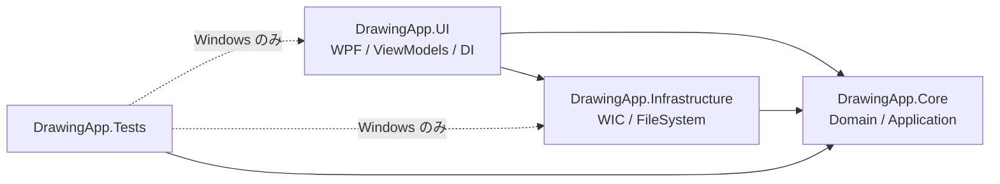
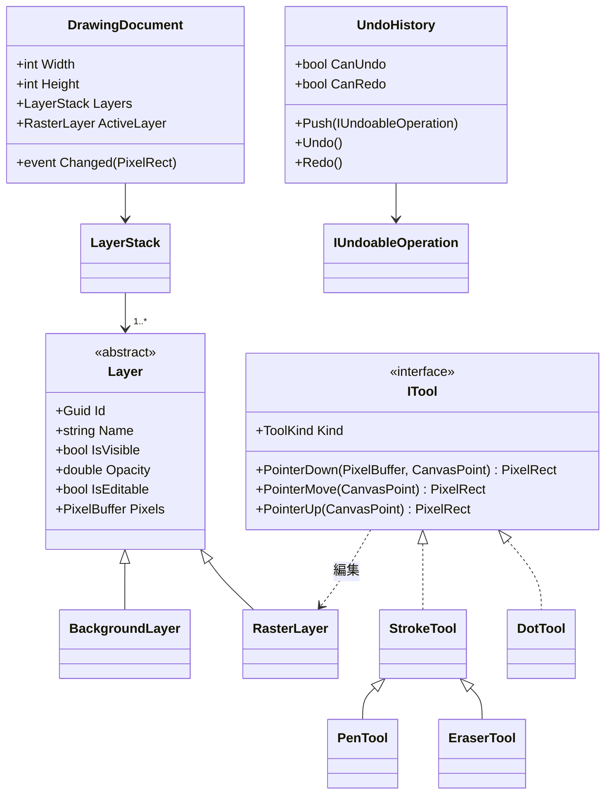
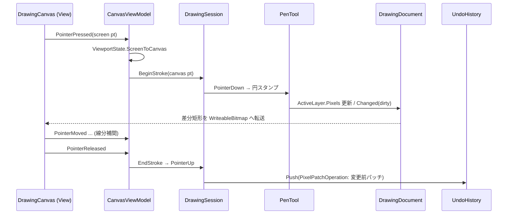
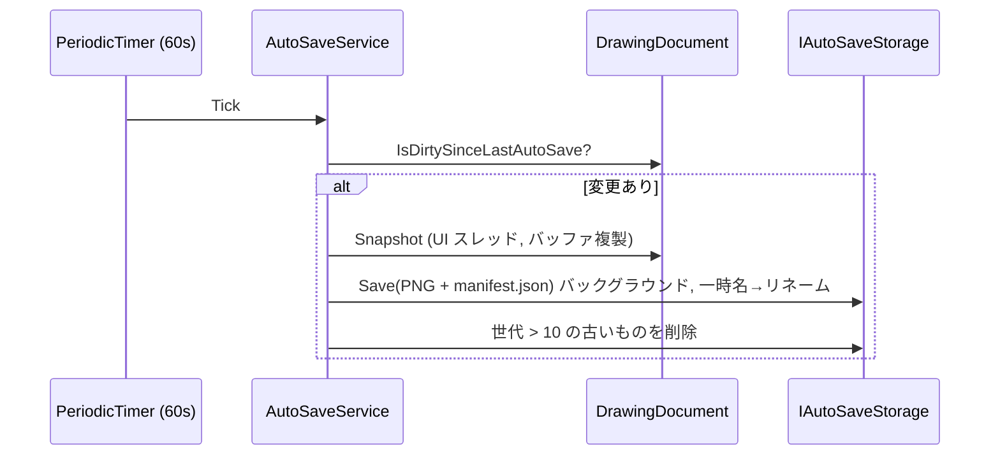

# Architecture

DrawingApp のアーキテクチャ設計書。要求・仮定は [ProductBacklog.md](ProductBacklog.md)、リスクは [Risks.md](Risks.md) を参照。

## 1. 設計方針

| 方針 | 内容 |
|----|----|
| Clean Architecture | ドメイン・ユースケースを `DrawingApp.Core` に集約し、UI・OS 依存 (WPF / WIC / ファイル) は外側の層に置く |
| MVVM | View (XAML) はバインディングと入力転送のみ。状態とロジックは ViewModel、ドメイン処理は Core |
| Dependency Injection | `Microsoft.Extensions.Hosting` の Generic Host をコンポジションルートとする |
| テスト容易性 | Core は `net10.0` (OS 非依存) とし、どの OS でも Unit Test 可能にする。時間・ファイル・画像コーデックはポート (interface) で抽象化 |
| 拡張性 | レイヤー・ツール・エンコーダを抽象化し、色/複数レイヤー/図形/テキスト/SVG/WebP を既存コードの改修最小で追加可能にする |

## 2. ソリューション構成

```
DrawingApp.slnx
global.json                      .NET 10 SDK 固定
Directory.Build.props            共通ビルド設定 (Nullable, TreatWarningsAsErrors, Analyzers)
Directory.Packages.props         NuGet 版数の一元管理 (Central Package Management)
src/
  DrawingApp.Core/               net10.0          ドメイン + アプリケーション層
  DrawingApp.Infrastructure/     net10.0-windows  WIC 画像入出力, ファイル保存, 時計
  DrawingApp.UI/                 net10.0-windows  WPF View / ViewModel / コンポジションルート
tests/
  DrawingApp.Tests/              xUnit (Windows: net10.0-windows / その他 OS: net10.0 で Core のみ)
docs/
  README.md  Architecture.md  UserManual.md  ProductBacklog.md  Roadmap.md  Risks.md
.github/workflows/ci.yml
```

### 依存方向



- Core は他プロジェクト・WPF・`System.Windows.*` を参照しない
- ViewModel は `System.Windows.*` を参照しない (WPF 型は View とアダプタに閉じ込める)
- UI が Infrastructure を参照するのはコンポジションルート (DI 登録) のみ

## 3. レイヤー詳細

### 3.1 DrawingApp.Core

```
Core/
  Domain/
    Imaging/       PixelBuffer (BGRA32), RgbaColor, PixelRect, CanvasPoint
    Layers/        Layer (abstract), BackgroundLayer, RasterLayer, LayerStack
    Documents/     DrawingDocument (キャンバスサイズ + LayerStack + 変更通知)
    Tools/         ITool, StrokeTool (PenTool / EraserTool), DotTool, ToolKind, ToolOptions, BrushSizePresets
    Rasterization/ RoundBrushRasterizer, BlendMode (Paint / Erase)
    History/       IUndoableOperation, PixelPatchOperation, UndoHistory
    Viewport/      ViewportState (Scale, Offset), ZoomPolicy (10%〜800%)
  Application/
    Ports/         IImageDecoder, IImageEncoder, IImageEncoderRegistry, IAutoSaveStorage, IClock
    Services/      DrawingSession, DocumentService, ExportService, LayerCompositor, AutoSaveService
  DependencyInjection/ CoreServiceCollectionExtensions.AddCore()
```

主要モデル:



- **PixelBuffer**: `byte[]` の BGRA32 (非乗算 α)。WPF の `WriteableBitmap` (`Bgra32`) と同レイアウトで、表示時はコピーのみ
- **レイヤー分離**: ツールは `DrawingDocument.ActiveLayer` (常に `RasterLayer`) のみを編集する。`BackgroundLayer` は `IsEditable=false` で、ツールへの公開 API を持たない
- **消しゴム**: `BlendMode.Erase` で描画レイヤーの α を 0 にする。背景は別バッファのため影響しない
- **色**: `ToolOptions.Color` (`RgbaColor`) をストローク開始時に取得してラスタライザへ渡す。初版は `RgbaColor.Black` 固定
- **ツール**: `ITool` の各メソッドは変更した領域 (`PixelRect`) を返す。`DrawingSession` が `ToolOptions.ActiveTool` に対応するツールへポインタ入力を振り分け、`Invalidated` イベントで差分矩形を通知する。ツールは DI で `ITool` として複数登録する (Undo 用の `IUndoableOperation` 生成は Phase6 で追加)
- **ラスタライズ**: `RoundBrushRasterizer` はアンチエイリアスなしの円ブラシ。奇数サイズはピクセル中心、偶数サイズはピクセル角に中心をスナップし、n px ブラシが正確に n px 幅になる。線分は `max(1, サイズ/4)` px 間隔でスタンプして途切れを防ぐ
- **ブラシサイズ**: `BrushSizePresets.Pen/Dot = {1,3,5,10,20}`, `Eraser = {10,20,50}`

### 3.2 DrawingApp.Infrastructure

| クラス | ポート | 実装 |
|----|----|----|
| `WicImageDecoder` | `IImageDecoder` | `BitmapDecoder` で PNG/JPG/JPEG を読込み、`FormatConvertedBitmap` で BGRA32・96DPI に正規化 |
| `PngImageEncoder` | `IImageEncoder` | `PngBitmapEncoder` で α 付き PNG を出力 |
| `FileAutoSaveStorage` | `IAutoSaveStorage` | `%LOCALAPPDATA%\DrawingApp\AutoSave` に世代ディレクトリを作成・列挙・削除 |
| `SystemClock` | `IClock` | `TimeProvider.System` |

`AddInfrastructure()` で登録する。

### 3.3 DrawingApp.UI

```
UI/
  App.xaml(.cs)        Generic Host 起動 / 終了
  Hosting/             UiServiceCollectionExtensions.AddUi()
  Views/               MainWindow.xaml, DrawingCanvas (UserControl)
  ViewModels/          MainViewModel, ToolbarViewModel, CanvasViewModel
  Services/            IDialogService (ファイル選択・メッセージ), WpfDialogService
  Rendering/           LayerBitmapPresenter (PixelBuffer → WriteableBitmap 差分転送)
```

- MVVM ライブラリ: `CommunityToolkit.Mvvm` (`ObservableObject`, `[ObservableProperty]`, `[RelayCommand]`)
- キーバインド: `Ctrl+Z` → `UndoCommand`, `Ctrl+Y` → `RedoCommand` (`Window.InputBindings`)
- 表示: `ScrollViewer` 不使用。`DrawingCanvas` 内で背景 `Image` と描画 `Image` を重ね、`ViewportState` から生成した `MatrixTransform` を適用。高倍率時は `BitmapScalingMode=NearestNeighbor`

## 4. 主要フロー

### 4.1 ペン描画



### 4.2 保存

- 描画のみ: `ExportService.SaveDrawingOnly(path)` → `ActiveLayer.Pixels` をそのまま `IImageEncoder(png)` へ (透過保持)
- 合成: `LayerCompositor.Compose(LayerStack)` で可視レイヤーを下から α 合成 (`Opacity` 考慮) → PNG

### 4.3 Undo / Redo

- 1 操作 (1 ストローク / 1 点 / 1 消去ドラッグ) = 1 `PixelPatchOperation`
- 変更前の dirty 矩形パッチのみ保持。Undo 時に現状をパッチ化して Redo 用に入れ替える (メモリ半減)
- パッチは Deflate 圧縮。`UndoHistory` は件数上限 (既定 50) とバイト上限を持ち、古い順に破棄 (20 件は保証)
- 新規操作で Redo スタックをクリア。下絵読込で履歴をクリア

### 4.4 ズーム / パン

- `ZoomPolicy`: 段階テーブル `10,15,20,25,33,50,67,75,100,125,150,200,300,400,600,800 (%)`。ホイール 1 ノッチで 1 段階
- カーソル位置アンカー: `offset' = cursor - (cursor - offset) * (scale' / scale)` (純粋関数として Core でテスト)
- パン: 中ボタンドラッグ、または Space 押下中の左ドラッグで `Offset` を加算

### 4.5 オートセーブ



- 周期・世代数・保存先は `AutoSaveOptions` (DI の Options パターン) で設定可能
- 例外はログ出力のみでアプリを落とさない

## 5. DI 登録とライフタイム

| サービス | ライフタイム | 登録元 |
|----|----|----|
| `DrawingDocument`, `UndoHistory`, `DrawingSession` | Singleton (1 ウィンドウ = 1 ドキュメント) | `AddCore()` |
| `DocumentService`, `ExportService`, `LayerCompositor`, `AutoSaveService` | Singleton | `AddCore()` |
| `IImageDecoder`, `IImageEncoder` (複数), `IAutoSaveStorage`, `IClock` | Singleton | `AddInfrastructure()` |
| `MainWindow`, `MainViewModel`, 子 ViewModel, `IDialogService` | Singleton | `AddUi()` |

`ServiceProviderOptions.ValidateOnBuild/ValidateScopes = true` で起動時に登録漏れを検出し、同等の検証を Unit Test でも行う。

## 6. 拡張ポイント

| 将来要求 | 拡張方法 |
|----|----|
| 色選択 | `ToolOptions.Color` を ViewModel から変更可能にし、カラーピッカー View を追加 |
| 複数レイヤー | `LayerStack` に `RasterLayer` を追加し `ActiveLayer` を切替。合成は N レイヤー対応で設計 |
| 表示/非表示・透明度 | `Layer.IsVisible / Opacity` を表示 (`Image.Opacity/Visibility`) と `LayerCompositor` に反映 |
| 図形描画 | `ITool` 実装 (`RectangleTool` 等) を追加し `ToolKind` に登録 |
| テキスト描画 | `ITool` + テキストラスタライザ (Infrastructure の WPF `FormattedText` アダプタ) |
| SVG 出力 | 操作ログ (ストローク座標列) を `IVectorExporter` で出力。ラスタは `<image>` 埋め込みで代替可 |
| WebP 出力 | `IImageEncoder` を追加登録すると保存ダイアログのフィルタに自動反映 (`IImageEncoderRegistry`) |

## 7. エラーハンドリング・スレッド

- ドキュメント操作は UI スレッドのみ。重い処理 (エンコード・ファイル I/O) は `Task.Run` へ
- ファイル I/O・デコード例外はアプリケーション層で捕捉し `IDialogService.ShowError` で通知
- 未処理例外は `DispatcherUnhandledException` / `TaskScheduler.UnobservedTaskException` でログ化

## 8. テスト戦略

| 対象 | テスト種別 | 実行 OS |
|----|----|----|
| Core (レイヤー分離, ラスタライズ, Undo/Redo, ズーム計算, オートセーブ世代管理, 合成) | Unit | 全 OS |
| Infrastructure (PNG 保存/読込往復, AutoSave ファイル操作) | Unit (一時ディレクトリ) | Windows |
| ViewModel (コマンド可否, ツール選択, 倍率表示) | Unit (ポートはフェイク) | Windows |
| 100 回繰り返し耐久 | シナリオ (アプリケーション層) | Windows |

- フレームワーク: xUnit + coverlet (Cobertura) + ReportGenerator
- テストプロジェクトは OS に応じて TFM を切替え、Windows 以外では Core のみをビルド・実行する
- カバレッジ目標 80% (行)。XAML View と `App` 起動コードは計測対象外 (`[ExcludeFromCodeCoverage]`)

## 9. CI/CD 設計

`.github/workflows/ci.yml`

| 項目 | 設定 |
|----|----|
| トリガ | `pull_request` (全ブランチ), `push` (main), `workflow_dispatch` |
| ランナー | `windows-latest` (WPF ビルド・テストのため) |
| SDK | `actions/setup-dotnet` (`global-json-file: global.json`) |
| 手順 | `dotnet restore` → `dotnet build -c Release --no-restore` → `dotnet test -c Release --no-build --collect "XPlat Code Coverage"` → ReportGenerator |
| 失敗条件 | ビルドエラー / 警告 (`TreatWarningsAsErrors`) / テスト失敗。Phase9 以降はカバレッジ 80% 未満も失敗 |
| 成果物 | テスト結果 (TRX), カバレッジ HTML (Artifact), Markdown サマリ (Job Summary) |
| その他 | `concurrency` で同一 PR の古い実行をキャンセル、NuGet キャッシュ |

## 10. 非機能要求への対応

| 要求 | 対応 |
|----|----|
| 起動 3 秒以内 | 起動時はウィンドウ表示に必要なサービスのみ生成。ReadyToRun は必要に応じて検討 |
| メモリ 300MB 以下 | 1 レイヤー = W×H×4 byte (1920×1080 で約 8MB)。Undo は差分圧縮パッチ + バイト上限 |
| 100 回繰り返しで異常終了しない | イベント購読解除・ビットマップ再利用、耐久シナリオテストで検証 (PBI-21) |
