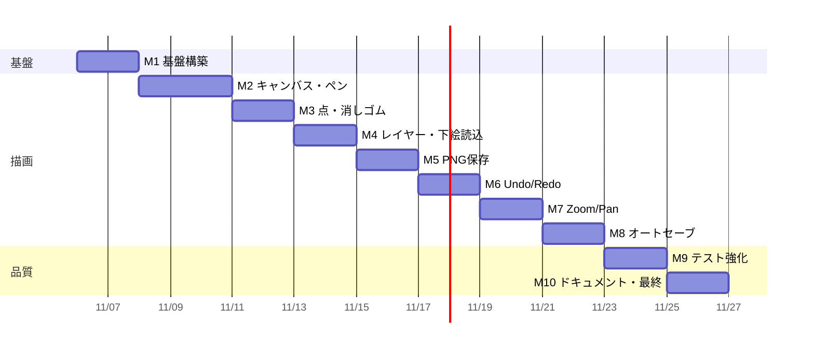
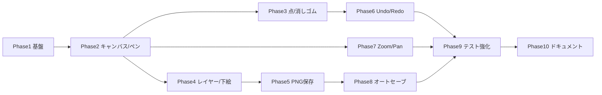

# 実装ロードマップ

各フェーズは GitHub Milestone (M1〜M10) に対応する。1 PR = 500 行以下を目標とし、
各 PR で「ビルド可能」「Unit Test 同梱」「関連ドキュメント更新」を満たす。

日程は目安 (1日 ≒ 2〜3 PR)。

## フェーズ別 PR 計画

| Phase | Milestone | 予定PR | 主な成果物 | Issue |
|----|----|----|----|----|
| 0 | M1 | 計画ドキュメント | Backlog / Roadmap / Risks | #1 |
| 0 | M1 | 設計ドキュメント | Architecture.md / README.md / CI設計 | #1 |
| 1 | M1 | ソリューション + MVVM + DI | slnx, 4プロジェクト, MainWindow/MainViewModel, Host | #2 #3 #4 |
| 1 | M1 | CI | `.github/workflows/ci.yml`, カバレッジレポート | #5 |
| 2 | M2 | Core 描画モデル | PixelBuffer, RgbaColor, BrushRasterizer | #6 #7 |
| 2 | M2 | キャンバス UI + ペン | DrawingCanvas, PenTool, ペンサイズ | #6 #7 #8 |
| 3 | M3 | 点ツール | DotTool, 点サイズ | #9 |
| 3 | M3 | 消しゴム | EraserTool, 消しゴムサイズ | #10 |
| 4 | M4 | レイヤーモデル | Layer, LayerStack, DrawingDocument | #11 |
| 4 | M4 | 下絵読込 | IImageDecoder (WIC), ファイルダイアログ | #12 |
| 5 | M5 | PNG エンコーダ | IImageEncoder, PngImageEncoder | #13 |
| 5 | M5 | 保存機能 | 描画のみ保存 / 合成保存, LayerCompositor | #14 #15 |
| 6 | M6 | 履歴 | UndoHistory, PixelPatch, Ctrl+Z/Y | #16 |
| 7 | M7 | ズーム | ZoomController, 倍率表示 | #17 |
| 7 | M7 | パン | PanController, 中ボタン / Space | #18 |
| 8 | M8 | オートセーブ | AutoSaveService, 世代管理 | #19 |
| 9 | M9 | テスト強化 | カバレッジゲート, 耐久テスト, 性能計測 | #20 #21 #22 |
| 10 | M10 | ドキュメント | UserManual.md, 最終化 | #23 #24 #25 |

## 依存関係

## 運用ルール

- ブランチ: `devin/<timestamp>-<slug>` などのフィーチャーブランチ → PR → レビュー後マージ
- PR には関連 Issue (`Closes #NN` / `Refs #NN`) と置いた仮定を記載する
- CI (restore / build / test) が成功しない PR はマージしない
